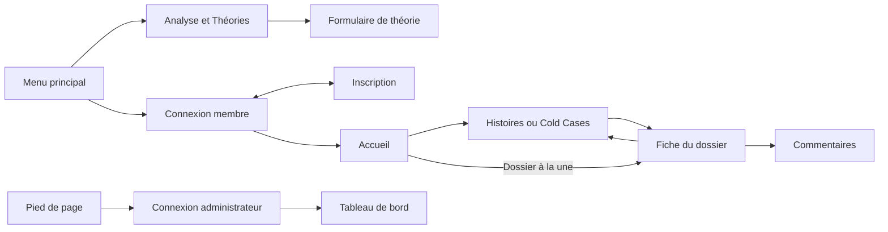
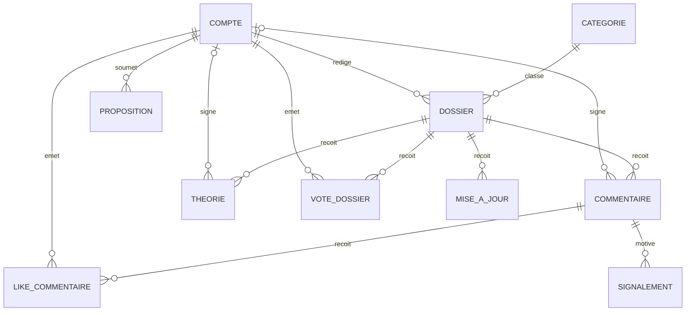
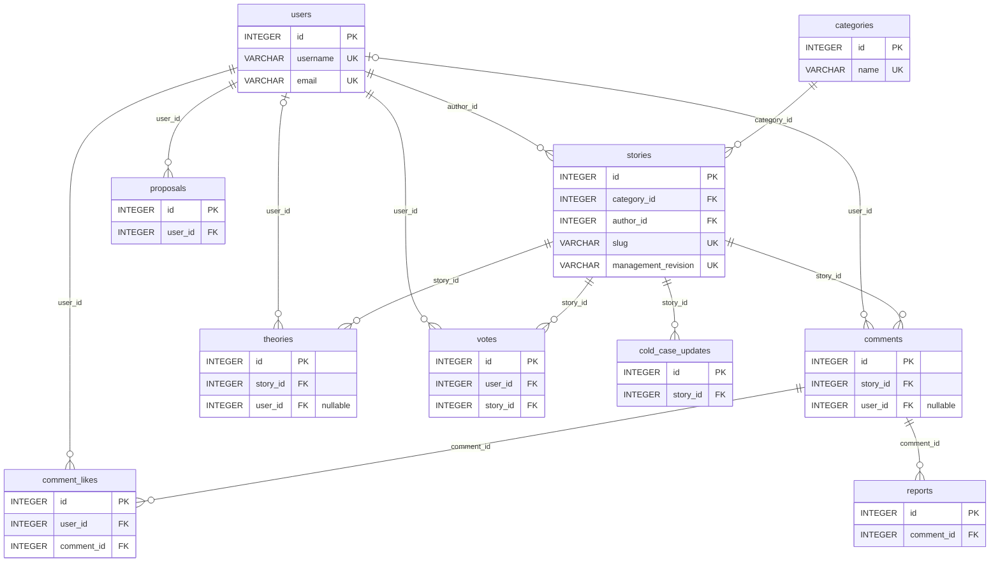
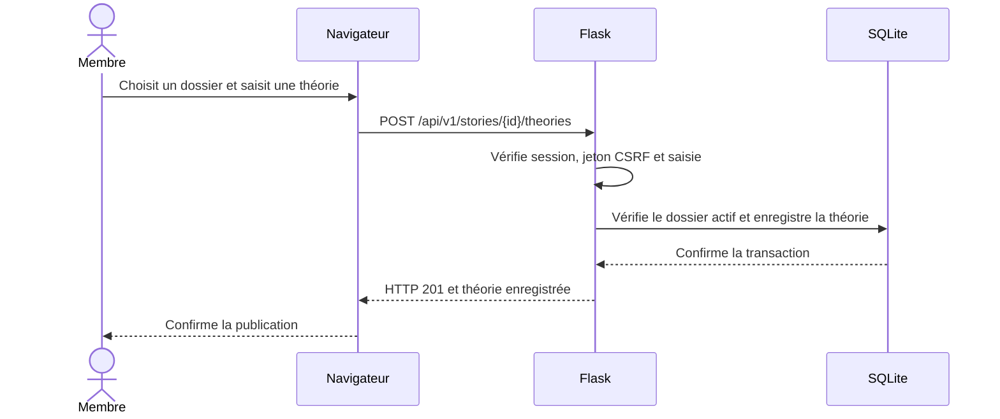

# Criminal Stories Blog

**Criminal Stories Blog**, présenté dans l’interface sous le nom **Les Petits Enquêteurs**, est un blog d’enquêtes développé pour le titre DWWM de niveau 5. Il propose des affaires résolues, des Cold Cases et des espaces de contribution.

- **Visiteur** · Lire les dossiers, rechercher une affaire et consulter les contributions.
- **Membre** · Publier une théorie ou un commentaire, proposer une histoire et interagir avec les contenus.
- **Administrateur** · Consulter le tableau de bord et les signalements, gérer les dossiers et les comptes.

L’interface utilise HTML, CSS et JavaScript. Flask sert les pages et l’API sur la même adresse. SQLAlchemy relie l’API à une base SQLite locale.

## Démarrer sous Windows

Prérequis · Python 3.13 et Git. Ouvrir PowerShell dans le dossier du dépôt.

```powershell
git clone https://github.com/Mahamadou19-75/RNCP.git
cd RNCP
py -3.13 -m venv .venv
.\.venv\Scripts\python.exe -m pip install -r backend/requirements.txt
.\.venv\Scripts\python.exe -I -B tools/demo_persistante.py init
.\.venv\Scripts\python.exe -I -B tools/demo_persistante.py check
.\.venv\Scripts\python.exe -I -B tools/demo_persistante.py serve
```

À la première initialisation, choisis en console privée les adresses de démonstration et les mots de passe des comptes `admin`, `Alice` et `Bob`. Le lanceur prépare six dossiers. Si tu pars d’une archive décompressée, exécute `git init` dans ce dossier avant la commande `init`.

- [Ouvrir le site](http://127.0.0.1:5066/)
- [Ouvrir l’administration](http://127.0.0.1:5066/admin-connexion.html)
- [Consulter l’API dans Swagger](http://127.0.0.1:5066/api/v1/swagger)

Pour les séances suivantes, lance `check`, puis `serve` dans la même copie. Les comptes et contributions restent dans `instance/demo-persistante/`. Les fichiers de données et la clé de session sont exclus de Git.

## Démonstration devant le jury

1. Depuis l’accueil, ouvre le dossier à la une et repère sa catégorie.
2. Connecte-toi avec un compte membre de démonstration et ouvre **Analyse & Théories**.
3. Sélectionne le dossier, saisis un titre et un texte, puis publie la théorie.
4. Dans **Théories publiées**, sélectionne le même dossier et clique sur **Actualiser**. La contribution enregistrée s’affiche.
5. Ouvre la même interface sur une largeur mobile pour montrer le réagencement de l’accueil et de la fiche.

## Schémas

### 1. Enchaînement des écrans · Diagramme de navigation

Le schéma présente les accès à la lecture, à la contribution et à l’administration.



### 2. Modèle conceptuel · Diagramme entité-association

Chaque relation indique les cardinalités. Par exemple, un dossier appartient à une catégorie et peut recevoir plusieurs commentaires. Un commentaire ou une théorie peut conserver son lien au dossier si la référence au compte auteur est effacée.



### 3. Schéma physique SQLite · Tables et clés

Les dix tables ci-dessous montrent leurs clés primaires, leurs références et les champs d’unicité essentiels. Le schéma complet figure dans [les modèles SQLAlchemy](backend/models.py).



- Les paires `(user_id, story_id)` dans `votes` et `(user_id, comment_id)` dans `comment_likes` sont uniques.
- `comments.user_id` et `theories.user_id` utilisent `SET NULL`. Les références de `stories` vers son auteur et sa catégorie gardent le comportement par défaut. Les autres références du schéma utilisent `CASCADE`.

### 4. Publication d’une théorie · Diagramme de séquence



## Vérifications

Les recettes utilisent une base SQLite en mémoire et des données de démonstration. Node.js sert aux tests de l’interface.

```powershell
.\.venv\Scripts\python.exe -I -B tools/recette_lot6g4.py --check-journey
.\.venv\Scripts\python.exe -I -B tools/recette_lot6g4.py --histoires-originales --check-histoires
.\.venv\Scripts\python.exe -B -m unittest discover -s tests -p test_demo_persistante.py
node --test frontend/tests/*.test.cjs
```

Les comptes de démonstration sont initialisés localement. Swagger documente les routes disponibles. L’inscription publique crée un compte membre.

## État de la version RNCP

| Catégorie | Points |
| --- | --- |
| Retiré du démarrage et du code de connexion | Base MySQL hébergée sur Aiven, dépendances MySQL et Alembic, commandes de migration. Le lanceur crée le schéma SQLite à l’initialisation. |
| Changé | Palette bleu nuit et ambre doux, dossier à la une, lecture de la fiche sur ordinateur et mobile, accès direct aux commentaires, clés étrangères activées sur les connexions SQLite. |
| À améliorer | Vérifier les parcours sur des téléphones réels, optimiser le poids des illustrations, automatiser les tests à chaque envoi sur GitHub et documenter un parcours complet de modération. |
